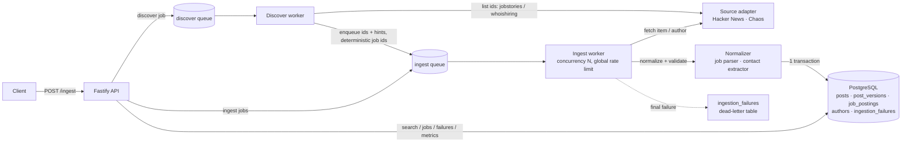

# HN Ingestion Engine

A fault-tolerant ingestion pipeline that collects job posts from Hacker News (YC company job posts and the monthly **"Ask HN: Who is hiring?"** threads), normalizes them into a consistent schema, extracts structured job data and contacts, and serves it through a search API.

The point of the project is not the scraping. It's what happens when the upstream is **slow, rate-limited, flaky, returns partial or wrong data, edits content after you've stored it, and sends you the same thing twice**. The system is built, and tested, to stay consistent under all of that.

```
TypeScript · Node 22 · PostgreSQL 16 · Redis 7 + BullMQ · Fastify · Zod · Pino · Prometheus · Docker · Vitest
```

## Architecture



**Flow for one item:** fetch → validate & normalize → (best-effort) author profile enrichment → one transaction that upserts the post, writes a version if content changed, upserts the job posting, and closes any open dead-letter entries for that item.

Network calls happen *before* the transaction, so no row locks are held while waiting on upstream.

## Failure scenarios and how they're handled

| Scenario | What the system does | Where |
|---|---|---|
| **Upstream 429 / rate limit** | Pauses the *whole queue* for `Retry-After`; the job does **not** lose an attempt | `worker/workers.ts` |
| **Self-imposed rate limit** | Global limiter across all worker processes (default 10 req/s) | BullMQ `limiter` |
| **Timeout, 5xx, connection reset, truncated JSON** | Classified as transient → retried with exponential backoff + jitter (so failures don't retry in lockstep) | `domain/errors.ts`, `queue/queues.ts` |
| **Item doesn't exist / wrong item returned** | Classified as permanent → no retries → written to the `ingestion_failures` dead-letter table | `normalize.ts` |
| **Retries exhausted** | Dead-lettered with error class, message, attempts, payload; replayable via `POST /failures/:id/retry` | `ingestion_failures` |
| **Same item enqueued twice** | Layer 1: deterministic BullMQ job id drops the duplicate. Layer 2: `UNIQUE(source, external_id)` + `INSERT … ON CONFLICT` | `queue/queues.ts`, `db/repository.ts` |
| **Two workers race on the same new item** | `ON CONFLICT DO NOTHING` then `SELECT … FOR UPDATE`; exactly one insert wins | `upsertPost` |
| **Out-of-order delivery** (older fetch lands after newer) | Compares fetch timestamps; older write is dropped as `stale` | `upsertPost` |
| **Content edited upstream** | Content hash changes → old row snapshotted into `post_versions`, version bumped | `upsertPost` |
| **Only volatile fields changed** (score, replies) | Excluded from the hash → updated in place, no version noise | `contentHash` |
| **Partial / malformed fields** | Stored anyway; bad fields become `NULL` and are listed in `quality_issues` | `normalizeHnItem` |
| **Post deleted upstream** | Marked `deleted`; its job posting (and contacts) is removed from the API | `ingestItem` |
| **Author profile fetch fails** | Enrichment is best-effort: post still ingests with the contacts in the post itself | `ingestItem` |
| **Worker restarts mid-job** | Graceful shutdown drains in-flight jobs; anything interrupted is redelivered by BullMQ, and processing is idempotent | `worker/main.ts` |
| **Redis memory pressure** | Redis runs with `noeviction` so queue state can't be silently dropped | `docker-compose.yml` |

### Proving it: the chaos source

`src/sources/chaos/source.ts` is a deliberately hostile upstream that emits HN-shaped payloads. It's seeded and deterministic, so tests can assert exact outcomes:

- 74% of items fail 1–3 times before succeeding (429s, timeouts, 503s, truncated bodies)
- some never exist, some return the wrong item, some come back with missing or ill-typed fields
- some are edited between fetches; some authors are permanently unreachable

`test/integration/chaos.test.ts` enqueues every item **twice concurrently** against real Postgres and Redis, then asserts:

- every valid item is stored **exactly once**, and nothing invalid is stored
- edited items end on the newest content, with history in `post_versions`
- only permanently broken items reach the dead-letter table, each with the right error class
- partial records are kept and flagged
- job contacts are extracted, and author enrichment failures don't block ingestion
- re-ingesting everything changes nothing (idempotency)

A typical run injects ~170 failures (~45 rate limits) across 120 items and converges to the exact expected state in a few seconds.

## Job extraction

| Origin | Source | Parsed from |
|---|---|---|
| `yc_jobs` | `/jobstories` (YC company posts) | Title, e.g. `Acme (YC W24) Is Hiring a Founding Engineer (Remote)` → company, batch, role, location |
| `who_is_hiring` | Top-level comments of the monthly thread | Pipe header, e.g. `Acme \| Senior Engineer \| Berlin / REMOTE (EU) \| €90k–120k` → company, role, location, salary |

Contacts:

- **Emails** are de-obfuscated (`jane [at] acme [dot] com`, `jane (at) acme.io`, `jane at acme dot com`) and tagged `personal` (Gmail, Proton, …) or `work`.
- **LinkedIn** profile and company URLs are normalized.
- If the post has none, the poster's **public HN profile "about" field** is checked (cached for 24h).

**Role tags.** Each job is tagged `founding`, `backend`, `fullstack`, `frontend`, `ai` and/or `software`, based on the role, title and top of the post. Non-dev "engineer" roles (sales, hardware, QA…) and prose like "our founding team" are excluded. Filter with `GET /jobs?tags=founding,backend&remote=true`.

**Remote eligibility.** On HN, "Remote" very often means "remote within the US". Each remote job gets a `remote_scope` (`worldwide`, `regional`, `unstated`) and `remote_regions` (us, europe, emea, africa, latam, apac…). Only the location field, the header line and text around the word "remote" are read, and "US" is matched case-sensitively so "contact us" doesn't count. `GET /jobs?open_to=nigeria` returns jobs open worldwide or to Africa/EMEA; add `include_unstated=true` for remote posts that don't say where.

**Replay without re-fetching.** After improving a parser, `npm run reprocess` re-derives every job posting from the raw payloads already in Postgres. Author-profile contacts come from the `authors` cache, so nothing is lost.

The parser prefers `NULL` to a wrong guess. On a real thread, it fills company for ~95% of posts, location ~92%, role ~73% (many posts don't name a role in the header), and finds an email in ~40%.

## Running it

**Prerequisites:** Node 22+ and Docker.

```bash
npm install
docker compose up -d          # Postgres :5433, Redis :6380
npm run migrate
npm run worker                # terminal 1
npm run api                   # terminal 2 → http://localhost:3000
```

Or run the full stack in containers, chaos source included:

```bash
docker compose --profile app up -d --build
```

Tests (unit + chaos integration; needs the compose infra running):

```bash
npm test
```

## API

```bash
# Discover and ingest
curl -X POST localhost:3000/ingest -H 'content-type: application/json' -d '{"scope":"jobstories"}'
curl -X POST localhost:3000/ingest -H 'content-type: application/json' -d '{"scope":"whoishiring","limit":200}'
curl -X POST localhost:3000/ingest -H 'content-type: application/json' -d '{"ids":[8863, 121003]}'
# add "force": true to bypass queue-level dedup and re-fetch

# Track
curl localhost:3000/queues/discover/jobs/1
curl localhost:3000/stats

# Query  (open http://localhost:3000/ for the jobs viewer)
curl "localhost:3000/jobs?q=typescript&remote=true&has_email=true"
curl "localhost:3000/jobs?open_to=nigeria&tags=founding,backend,fullstack,frontend,ai&sort=newest&page=2&limit=20"
curl "localhost:3000/jobs?since=2026-11-13T00:00:00Z"     # posted since a date; sort=oldest also works
curl "localhost:3000/jobs.csv?remote=true" -o jobs.csv
curl "localhost:3000/posts?q=postgres&kind=story"
curl localhost:3000/posts/hackernews/8863          # includes version history + job data

# Operate
curl localhost:3000/failures                       # open dead-letter entries
curl -X POST localhost:3000/failures/12/retry
curl localhost:3000/metrics                        # Prometheus (API + queue depth)
curl localhost:9100/metrics                        # Prometheus (worker)
```

Discovery scopes: `jobstories`, `whoishiring`, `whoishiring:<threadId>`, `topstories`, `newstories`, `beststories`, `askstories`, `showstories`.

Set `DISCOVERY_EVERY_MINUTES=30` to have the worker discover YC jobs and the current hiring thread on a schedule.

## Project layout

```
src/
  api/            Fastify app (routes, validation) + entrypoint
  worker/         BullMQ workers, error policy, entrypoint
  pipeline/       ingestItem: fetch → normalize → enrich → persist
  sources/        SourceAdapter implementations: hackernews/, chaos/
  normalize/      HTML → text, job header parsing, contact extraction
  db/             pool, migrations runner, repository (upserts), read queries
  queue/          queue setup, job ids, backoff
  domain/         types and error taxonomy
migrations/       SQL schema
test/unit         parser / normalizer / backoff tests
test/integration  chaos end-to-end test (real Postgres + Redis)
```

## Design decisions

- **Postgres is the source of truth; Redis is disposable.** If Redis is wiped, re-running discovery rebuilds the queue, and idempotent upserts mean nothing is duplicated.
- **Classify errors, don't just catch them.** Retry policy is driven by an explicit taxonomy (`rate_limited`, `transient`, `not_found`, `invalid_payload`, `permanent`, `internal`). Unknown errors are retried, because losing data costs more than a wasted retry.
- **Store raw alongside normalized.** Every row keeps the raw payload, so normalization bugs can be fixed and replayed without re-fetching.
- **Lenient on fields, strict on identity.** A bad `time` field shouldn't lose a job post; a payload for the wrong id must never be stored.
- **Sources are plugins.** Adding a source means implementing `fetchItem`, `normalize` and `discover`; the queueing, retries, dedup and storage come for free.

## Data & ethics

- Uses only the **official, public Hacker News API**, with a self-imposed rate limit and an identifying User-Agent. No scraping of HTML, no logged-in access, no other sites.
- Contacts are only those **the poster published themselves** in a hiring post or their own public HN profile, for the purpose of being contacted about jobs. No cross-site enrichment or lookup.
- When a post is deleted upstream, its job record and contacts are removed from the API.
- Collected data stays in your local database. Don't commit it or republish it in bulk.
